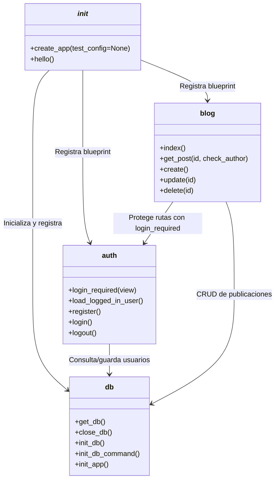

# Diagrama de Components

Descriure tots els components de l'aplicació

Components: db, _init_ , auth, blog

## db

Descripció : fFunciones de acceso y gestión de la base de datos.
Mètodes:
- get_db() : Devuelve la conexión activa a la base de datos.
- close_db() : Cierra la conexión al finalizar la petición.
- init_db() : Crea las tablas iniciales en la base de datos.
- init_app() : Registra la base de datos en la aplicación.
- init_db_command(): Registra el comando init-db en la interfaz de comandos de Flask para poder inicializar la base de datos desde la terminal.

## _ init _ 
Descripció : Inicialización y configuración de la aplicación web.
Mètodes:
- create_app(test_config=None) : Crea y configura la instancia de la aplicación.
- hello() : Página de prueba básica.

## auth
Descripció : Gestión de usuarios y autenticación。
Mètodes:
- login_required(view) : Filtro que protege vistas para usuarios autenticados.
- load_logged_in_user() : Carga el usuario activo en cada petición.
- register() : Maneja el registro de nuevos usuarios.
- login() : Maneja el inicio de sesión.
- logout() : Cierra la sesión del usuario.

## blog
Descripció : Gestión de las publicaciones del blog.
Mètodes:
- index() : Muestra la lista principal de publicaciones.
- get_post(id, check_author=True) : Obtiene un post por su ID y valida al autor.
- create() : Permite crear una nueva publicación.
- update(id) : Permite editar una publicación existente.
- delete(id) :  Borra una publicación.

